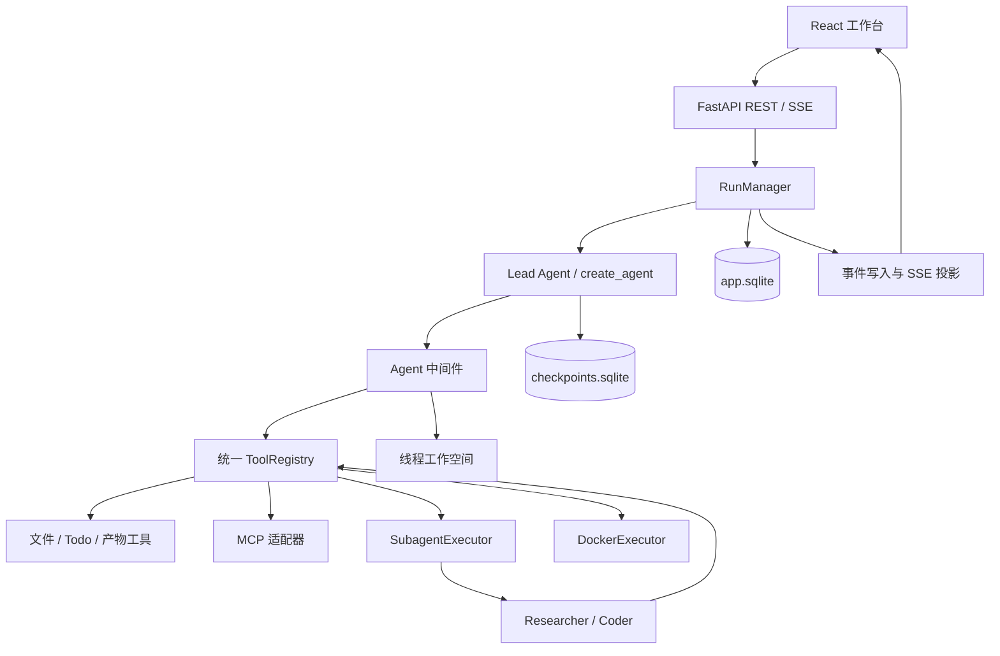
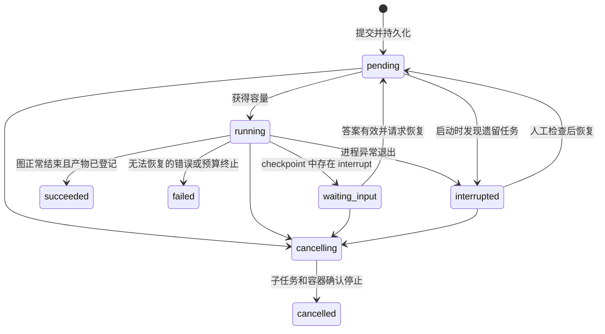
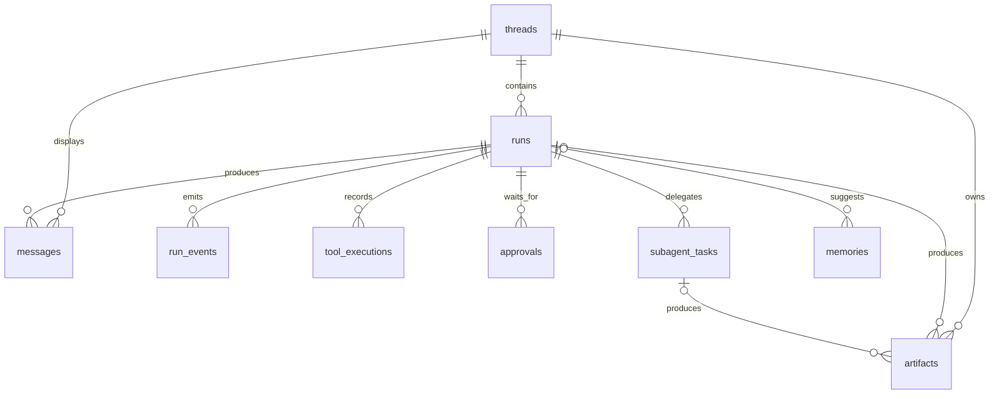
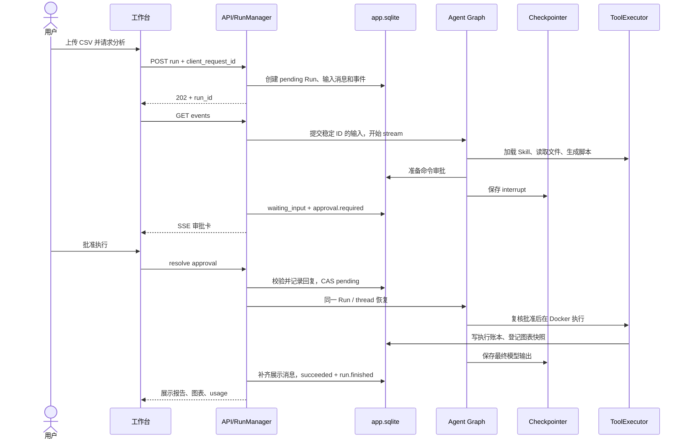

# AgentLoom（织能）详细设计

状态：待实现的独立项目设计；实现进度以 PROGRESS.md 和真实代码为准。
设计日期：2026-10-04；学习流程修订：2026-10-05。
目标：以当前 DeerFlow 仓库为源码参照，边学边独立实现一个能读写文件、运行代码、加载技能、委派子任务并恢复执行的轻量级通用 Agent。

配套文件：

- [数据库 DDL](schema.sql)：可在空 SQLite 数据库执行的设计样例，不作用于 DeerFlow 数据库。
- [实现与学习路线](roadmap.zh-CN.md)：阶段任务、验收条件、代码阅读入口和面试准备。
- [交接说明](README.md)、[Codex 启动指令](CODEX_START.md)、[进度](PROGRESS.md)、[验收清单](ACCEPTANCE.md)。
- [学习流程](LEARNING.md)：一轮一个小单元；[原源码地图](UPSTREAM.md)：当前仓库路径、符号和精简映射。

阅读方式：先浏览第 1～3 节了解目标和模块，后续章节在对应单元再读。本文描述完整目标，不是要求第一轮全部生成的任务单。

## 1. 项目定位与约束

用户用自然语言提出任务，Agent 根据任务选择工具和 Skill，必要时委派子 Agent，在独立工作空间执行，展示过程并交付可下载的文件。

首版采用单用户、单 Gateway 进程、本地演示的部署范围；同时允许少量不同线程运行。同一线程只允许一个未结束 Run。保留 Skills、Sub-Agent、MCP、沙箱、上下文管理、人工介入和评测这些核心能力。

项目名为 AgentLoom，中文名“织能”；仓库目录使用 `agentloom`，Python 包名使用 `agentloom`，运行数据放 `.agentloom/`。名称表达把模型、工具、技能和子任务组织成可执行流程。

按用户确认的安排，在新的工作目录实现；以当前 `D:\Forksourcefolder\deer-flow` 的实际代码为每个核心单元的阅读依据，版本与路径记录在 PROGRESS.md。[原源码地图](UPSTREAM.md) 说明每步要读哪里、保留什么和简化什么。AgentLoom 的安装运行不依赖 DeerFlow 的源码包、配置或数据库；学习时需要读取原仓库。复用源码时保留适用的许可证及来源说明。

由 Codex 完成主要编码、测试和文档同步，并先导读相关原实现；用户参与预测行为、运行实验、阅读关键代码、复述和需求取舍。默认每次只完成 LEARNING.md 中的一个单元；M0～M6 是里程碑，不一次生成整个阶段。代码、技术验证与理解进度分别记录；未收到用户反馈不能声称已经学会。不要求用户手工敲完整代码，但需要能定位与解释自己的实现。

### 1.1 三个固定演示场景

| 场景 | 用户输入 | 预期产物 | 覆盖能力 |
| --- | --- | --- | --- |
| 数据分析 | 上传 CSV，分析趋势和异常并画图 | Markdown 报告、PNG 图表、分析脚本 | 文件、Skill、Docker 执行、审批、Artifacts |
| 小型代码任务 | 为一个练习模块修复缺陷并运行测试 | 修复文件、测试结果、改动说明 | Coder 子 Agent、执行凭证、失败处理 |
| 并行资料整理 | 比较两个方案，分别搜集资料并汇总 | 附来源的对比报告 | Researcher 子 Agent、并发、MCP、搜索 |

其中的报告生成只是一个任务场景。框架允许用户新增 Skill，而不改主 Agent 的执行代码。

### 1.2 首版范围

| 编号 | 需求 | 首版定义 | 可观察验收 |
| --- | --- | --- | --- |
| F01 | 会话与运行 | 创建线程、提交任务、查看历史、取消运行 | 刷新后能看到当前状态；重复提交不重复创建 |
| F02 | Agent 循环 | 模型选择工具，工具结果回到模型，直到完成或达到限制 | 一个任务完成至少两轮有依赖的工具调用 |
| F03 | 规划 | `write_todos` 保存结构化清单 | UI 随执行更新；清单不是不可变的预设工作流 |
| F04 | 文件工具 | 读取、创建、替换、列目录、检索、上传 | 线程 A 不能读取线程 B 的文件 |
| F05 | 命令执行 | 在 Docker 中执行 Bash/Python，固定镜像和超时 | 可运行分析脚本，超时后容器真正结束 |
| F06 | Skill | 元数据发现、按需加载、显式 `/skill`、工具范围约束 | 新增目录即可新增技能；普通请求不加载全部正文 |
| F07 | Sub-Agent | researcher、coder；独立上下文；最多同时 2 个 | UI 显示独立任务；一个子任务失败仍能汇总另一个 |
| F08 | MCP | 一个已配置 Server 的工具发现、适配、调用 | 能显示远程工具来源和失败原因 |
| F09 | 人工介入 | 执行命令、覆盖已有文件前确认；必要时追问 | 等待期间不执行动作；刷新或重启后可回答 |
| F10 | 持久化 | checkpoint、Run 状态、事件与消息历史 | 审批恢复有效；崩溃后显示中断并可检查恢复 |
| F11 | 上下文 | 大输出外置、摘要、近期完整工具交互保留 | 缩小上下文后仍记得任务、Todo 和产物位置 |
| F12 | 长期记忆 | 明确确认的用户偏好，支持查看、修改、删除 | 新线程能使用偏好，删除后后续调用不再注入 |
| F13 | 产物 | 注册、预览、下载生成的文件 | 文件不存在或为空时不能虚报交付成功 |
| F14 | 观测与评测 | 步骤、耗时、调用数、Token、错误和固定任务集 | 能比较两种配置在相同任务上的实际结果 |

不纳入首版：多用户 RBAC、IM 渠道、定时任务、可视化工作流编辑器、插件市场、K8s、分布式 worker、自动续跑目标、长期后台批任务、浏览器操作、ACP/A2A、完整 RAG 平台。以后按实际任务需要扩展。

### 1.3 规模和可靠性目标

以下是设计预算和验收目标，不是已经测出的性能：

- 1 个 Gateway worker；全局最多 2 个 Run 真正执行；同线程最多 1 个未结束 Run。
- 每 Run 最多 4 个子任务、同时运行 2 个；全进程子 Agent 并发也限制为 2。
- 每 Run 最多 24 次模型请求尝试、40 次工具实际执行；子任务与摘要共享总预算。
- 单工具结果给模型最多约 8 KB 文本；较大结果存文件，返回摘要与引用。
- 默认上传上限 10 MB/文件、每线程演示数据总量 100 MB；不做 OCR 和复杂文档解析。
- 外部模型和搜索耗时单独报告；服务端提交请求到返回 Run ID 的本地目标为 300 ms 内。
- SSE 每约 100 ms 合并文本增量；心跳 15 秒。LLM 首字延迟不是服务端固定承诺。
- 取消请求立即返回 `cancelling`，真正停止模型、子任务和容器后才写 `cancelled`。

## 2. 技术选型

| 层 | 推荐选择 | 作用与取舍 |
| --- | --- | --- |
| 后端语言 | Python 3.12 + uv | 与原项目接近，锁定依赖和解释器；首版只维护 Python |
| Agent | LangChain 1.x `create_agent` + LangGraph 1.x | 使用现成执行图和 checkpoint，自主实现策略、生命周期与工具能力 |
| 数据校验 | Pydantic 2 | HTTP DTO、工具参数、配置、Skill 元数据和子任务结果 |
| Web API | FastAPI + Uvicorn，1 worker | async 请求、上传、REST 管理接口、SSE |
| HTTP 客户端 | httpx.AsyncClient | 模型外的网络访问、超时、连接复用 |
| 应用持久化 | SQLite + SQLAlchemy 2.x async + aiosqlite + Alembic | 单机低运维成本；短事务；ORM 与迁移分离 |
| 图持久化 | `langgraph-checkpoint-sqlite` 的 async saver | 单独数据库文件；框架负责 checkpoint 表结构 |
| 前端 | React + TypeScript + Vite | 聊天、时间线、审批、文件面板；不需要服务端渲染 |
| 前端状态 | TanStack Query + 局部 React state | REST 状态与缓存；SSE 更新对应缓存 |
| UI | Tailwind CSS + 少量 shadcn/ui 组件 | 做可演示工作台；不复制整套 DeerFlow 前端 |
| Sandbox | Docker SDK + 预构建 Python 镜像 | Bash 在容器内执行；Docker 阻塞调用移入受控线程 |
| Skills | UTF-8 Markdown + YAML frontmatter | 包含说明、脚本和模板；三个自带 Skill |
| MCP | `langchain-mcp-adapters`；自建演示 Server 用官方 Python SDK | 先跑通一个受信任的本地 stdio Server |
| 模型 | 可配置的支持 tool calling 的 API 模型 | 一主一备配置即可；先验证中文、工具参数和结构化输出 |
| 观测 | 应用事件表 + 可选 LangSmith | 本地即能诊断，外部追踪由开发者配置开启 |
| 测试 | pytest、pytest-asyncio、前端 Vitest；少量浏览器 E2E | Mock 模型验证系统语义，真实模型验证任务效果 |
| 部署 | 本地启动后端/前端 + Docker 执行容器 | Windows 使用 Docker Desktop Linux containers；后端无需先容器化 |

版本规则：这里给出 API 代际，不声称某个 patch 永久兼容。M0 安装同一组稳定版本，完成 `create_agent`、async checkpoint、interrupt/resume、MCP 适配四个离线 smoke check 后记录到 `uv.lock`。前端到 M5 初始化时生成 pnpm lockfile；不要提前创建空前端。阶段过程中不随意升级，不使用未验证的 beta API。

M0.2～M0.3 曾使用手动 `StateGraph + model + tools + conditional edges` 实验观察工具循环和失败/终止；完成 M1 正式 `create_agent` 链后已删除这套临时代码，历史轨迹保留在 PROGRESS。正式应用只维护 `create_agent` 执行链，离线测试通过 `models/fake.py` 注入确定性模型。

模型 API 选型首先做兼容性验证，具体服务商依你的可用账号决定。模型适配器统一输出消息、tool calls、usage、finish reason。若 provider 未提供 usage，Token 计数标注估算或未知，不能按 0 冒充真实消耗。

实现两种显式模式：`fake` 使用确定性假模型经过真实图和工具链，支持无密钥开发；`live` 才调用配置的模型 API。假模型必须标记为离线演示，不能用固定最终答案或模拟成功绕过工具、审批和数据库。缺少 API key 不阻断离线实现，但真实模型兼容性与任务效果记为待验，不能把 Mock 测试当作 live 验收。

首版无需 Redis、Celery、Kafka、向量数据库。长期记忆只存少量经确认的偏好；后续独立增加知识库 Skill 时再引入 embedding、检索和向量索引。

### 2.1 配置与运行方式

以下是 AgentLoom 的配置契约。M0 根据它创建新的 config.example.yaml；它不依赖其他项目的配置格式：

```yaml
server:
  host: 127.0.0.1
  port: 8000
  workers: 1
  allowed_origins: ["http://127.0.0.1:5173"]
database:
  app_path: .agentloom/app.sqlite
  checkpoint_path: .agentloom/checkpoints.sqlite
models:
  default:
    provider: fake             # 本地默认；live 时切换为 openai_compatible
    model: scripted-tool-model # live 时填实际模型名
    base_url_env: MODEL_BASE_URL
    api_key_env: MODEL_API_KEY
    context_window: 32768       # fake 的测试预算；live 填实际服务规格
    max_output_tokens: 4096
runtime:
  max_running_runs: 2
  max_pending_runs: 8
  max_model_attempts_per_run: 24
  max_tool_executions_per_run: 40
  max_subagents_per_run: 4
  max_running_subagents: 2
sandbox:
  image: agentloom-python:v1
  network: none
  timeout_seconds: 60
  memory_mb: 512
skills:
  directory: ./skills
  max_active_per_agent: 1
context:
  compaction_fraction: 0.70
  tool_preview_bytes: 8192
tracing:
  external_enabled: false
```

`fake` 模式不读取密钥，不自动连接外部追踪或搜索；离线搜索使用明确标记的固定资料。`live` 模式缺少配置时返回可操作的配置错误，不能静默退回假模型。Docker 未安装时禁用 bash 并明确显示原因，不能降级为主机执行。

配置由 Pydantic 校验；密钥放 `.env`，快照只存环境变量名。Runtime/工具策略/模型配置在 Run 创建时冻结并记录版本，恢复使用同一份配置；紧急撤销某项能力可以使旧 Run 失败，但不能静默给它新增权限。MCP Server、镜像和资源上限等配置改变后重启应用。

开发时启动后端、Vite dev server 与 Docker Desktop。演示发布可以把前端 build 后交给 FastAPI 静态服务，同源监听 loopback。首版没有完整登录鉴权，支持范围是本机演示。

启动顺序：校验配置 -> 应用数据库迁移 -> 初始化 checkpointer -> 建立工具/MCP 注册表 -> 对账遗留 Run -> 开始接收请求。关闭顺序：停止入场 -> 请求取消/中断活动 Run -> 等待子任务及容器退出 -> 关闭 MCP、数据库和模型 HTTP 连接。`max_pending_runs` 达上限后拒绝新入场并返回可重试错误；不创建无界等待任务。

## 3. 架构与模块边界



图中的子 Agent 使用经过过滤的工具集合，不能再次调用 `task`；因此运行关系不递归。

| 模块 | 自己负责 | 不能承担的职责 |
| --- | --- | --- |
| API | DTO、HTTP 错误、上传、分页、SSE | 直接执行完整 Agent 或拼装所有提示词 |
| RunManager | 创建/恢复/取消 Run、容量、锁、资源生命周期、最终状态 | 决定业务任务怎样拆分 |
| AgentFactory | 模型、工具、状态、中间件组装 | 建数据库、读取 HTTP Request |
| ModelService | 单次模型尝试、重试、计费记录、并发容量 | 根据文本猜测任务已经成功 |
| ToolRegistry | 工具 schema、来源、权限、重放类别 | 管理网页连接或 Docker 对象的具体细节 |
| WorkspaceService | 路径、受控文件 I/O、不可变产物快照 | 执行任意主机 shell |
| SubagentExecutor | 子任务状态、独立上下文、并发和汇总 | 复制全部父消息、开启无限递归 |
| SkillLoader | 列出/加载技能、校验 frontmatter、固定版本 | 自行授予新工具权限 |
| Repositories | 短事务、条件更新、唯一约束 | 在事务内等待模型和网络调用 |

建议目录：

```text
agentloom/
├── AGENTS.md                     # Codex 项目约定，放在新项目根目录
├── README.md                     # 交接入口；开发后补运行方式
├── CODEX_START.md                # 导读、单元实现、续作和审查提示词
├── LEARNING.md                   # 边读原源码边实现的小步学习流程
├── PROGRESS.md                   # 实现进度、理解进度与验证证据
├── ACCEPTANCE.md                 # 行为验收清单
├── UPSTREAM.md                   # 当前 DeerFlow 源码阅读与精简映射
├── design.zh-CN.md
├── roadmap.zh-CN.md
├── schema.sql                    # 目标 DDL；应用使用 Alembic 迁移
├── backend/
│   ├── pyproject.toml
│   ├── src/agentloom/
│   │   ├── api/                  # routes、schemas、SSE
│   │   ├── runtime/              # RunManager、容量、恢复、事件
│   │   ├── agents/               # factory、state、roles
│   │   ├── middleware/           # 见第 7 节
│   │   ├── models/               # ModelService、provider 适配
│   │   ├── tools/                # registry、文件、搜索、Todo
│   │   ├── skills/               # loader、schema、policy
│   │   ├── subagents/            # executor、result contract
│   │   ├── sandbox/              # WorkspaceService、DockerExecutor
│   │   ├── mcp/                  # manager、adapter
│   │   ├── memory/               # 显式偏好记忆
│   │   └── persistence/          # models、repositories、迁移
│   └── tests/
├── frontend/
├── skills/{research,coding,data-analysis}/
├── mcp_servers/reference_library/
├── sandbox_image/Dockerfile
├── evals/{cases,fixtures,results}/
├── labs/
├── config.example.yaml
└── .agentloom/                   # gitignored 的本机数据
```

## 4. 核心领域与状态

### 4.1 六个必须区分的概念

| 概念 | 含义 | 例子 |
| --- | --- | --- |
| Thread | 连续对话及其工作空间 | “分析销售数据”的整段对话 |
| Run | 一次用户任务从提交到结束，可能多次暂停 | 本轮要求画销售趋势图 |
| Tool execution | 一次明确的工具调用 | `read_file("sales.csv")` |
| Subagent task | 一个独立子任务 | 请 Coder 生成分析脚本 |
| Artifact | 可定位、可验证、可下载的不可变文件 | 生成的 `sales.png` 快照 |
| Checkpoint | 图在某一步的执行状态 | 已调用模型，下一步等待用户批准 |

一个 Run 暂停后恢复仍用相同 Run ID 和 Thread ID。新的普通用户任务才创建新 Run。用户可以在审批/澄清界面回复；等待状态不接受另一个普通任务，返回 409。

### 4.2 AgentState 与 RuntimeContext

持久化 `AgentState` 存可序列化、恢复所需的信息：

| 字段 | 结构/更新规则 |
| --- | --- |
| `messages` | LangChain 消息；使用消息 reducer，通过稳定 message ID 更新 |
| `current_run_id` | 服务端写入；正常新 Run 更新，恢复时不变 |
| `todos` | `[{id, text, status}]`，由 Lead 单写；按 ID 合并 |
| `summary` | 较早历史的结构化摘要：目标、约束、已做工作、待办、文件引用 |
| `active_skills` | `[{name, content_hash, snapshot_ref}]`；按 name 合并 |
| `artifact_ids` | 有界 ID 列表，去重 |
| `delegations` | 有界子任务摘要，按 task ID 合并 |
| `stop_reason` | completed / budget_exceeded / loop_detected 等原因 |

RuntimeContext 存服务端建立的对象：Thread/Run ID、profile、WorkspaceService、ModelService、取消信号、预算控制器、事件记录器、允许的工具、MCP 客户端。密钥只通过服务端配置引用获取，不进入 State、工具参数、事件、checkpoint。

预算累计和工具执行账本保存在 app.sqlite。恢复时从数据库重建，不因 `before_agent` 再次执行而清零。Middleware 实例不保存跨 Run 的可变计数。

### 4.3 Run 状态机



`pending/running/waiting_input/interrupted/cancelling` 均占用线程未结束 Run 槽位。`waiting_input` 和 `interrupted` 不占用正在执行的全局容量。审批期间也保留线程写入排他权，避免修改文件使审批失效。

`succeeded` 表示执行流程按约定结束；任务语义是否正确由验收器或评测判断。子 Agent 声称“成功”、命令 exit code 为 0，都不能单独证明用户目标满足。

## 5. 数据库设计

### 5.1 三种存储的边界

| 存储 | 负责的数据 | 读取者 |
| --- | --- | --- |
| `app.sqlite` | 线程、Run、展示消息、事件、审批、执行账本、子任务、产物、偏好记忆 | API、RunManager、工具服务 |
| `checkpoints.sqlite` | LangGraph 的完整消息与执行位置 | graph/checkpointer；不手写它的内部表 |
| 工作空间文件 | 上传、代码、输出、大工具结果、已加载 Skill 快照 | 受控文件工具、Docker、Artifact API |

`messages` 是展示历史；`AgentState.messages` 是下一次模型调用的执行状态。上下文压缩只改后者，不删除 UI 的旧对话。任何恢复都通过 graph 的状态接口，不从展示表拼一个新对话冒充 checkpoint 恢复。

Skill、Agent profile、MCP Server 定义暂存版本化配置文件，不再建三套 CRUD 数据表。首版无用户表，记忆 `scope_key="local"`；未来多用户需要真正的身份与资源所有权设计，不能仅加一个 user_id 就认为已经隔离。

### 5.2 ER 关系



### 5.3 九张业务表

完整列、类型、CHECK、外键与索引见 [schema.sql](schema.sql)。ID 由后端生成 UUID 字符串；时间统一写 UTC ISO 8601；JSON 通过 Pydantic 校验后序列化，SQL 额外检查合法 JSON。

| 表 | 关键字段 | 写入时机/约束 |
| --- | --- | --- |
| `threads` | id、title、agent_profile、created_at、updated_at | 创建会话；删除先拒绝未结束 Run，V1 仅支持归档 |
| `runs` | thread_id、client_request_id、request_hash、input_json、input_message_id、status、config_snapshot_json、budget_json、checkpoint refs、usage、next_event_seq | 提交时入库；`(thread_id,client_request_id)` 唯一；每线程未结束 Run 部分唯一索引 |
| `messages` | thread_id、run_id、seq、scope、graph_message_id、role、content_json、status | 用户输入与完整模型/工具消息投影；Run+scope+message ID 幂等 |
| `run_events` | run_id、seq、event_type、scope、payload_json、created_at | 先提交再发 SSE；`(run_id,seq)` 为主键 |
| `tool_executions` | run_id、scope、tool_call_id、tool_name、args_hash、replay_class、status、result_json、precondition_json | 实际执行前登记；同一个逻辑调用只能有一条记录 |
| `approvals` | run_id、suspend_key、kind、payload_hash、payload_json、checkpoint_id、status、response_json、consumed_at | 中断前幂等准备；checkpoint 成功后才开放答复 |
| `subagent_tasks` | run_id、parent_tool_call_id、agent_type、status、prompt、result_json、acceptance_json、usage | 委派时登记；父 tool call 唯一定位子任务 |
| `artifacts` | thread_id、run_id、subagent_task_id、kind、relative_path、sha256、size_bytes、mime_type | 文件完整写好并捕获快照后登记；路径对线程唯一 |
| `memories` | scope_key、category、memory_key、content、status、source_run_id、version、expires_at | 显式保存/确认；按 scope+category+key 更新，支持版本冲突检测 |

M1 用一次 Alembic 基线迁移创建九张业务表，先实现 `threads/runs/messages/run_events` 的仓储与业务；其他表按阶段启用。这样 M2 的 artifacts 指向 subagent_tasks 的外键不会引用未创建的表。建立少量空表不等于提前实现全部功能。

`schema.sql` 是目标结构快照。新项目使用 SQLAlchemy 模型和 Alembic migration 管理数据库，应用启动不重复执行这份脚本，也不同时依赖 `create_all()` 维护另一套结构。结构调整同步这份快照和迁移，并测试“从空库迁移”和“升级后保留已有数据”。

### 5.4 事务和并发规则

1. `PRAGMA foreign_keys=ON` 对每个连接生效；本地数据库使用 WAL、合理 busy timeout。WAL 不会让 SQLite 同时拥有多个写者。
2. 先查相同 `client_request_id`：request hash 相同返回已有 Run，不同返回 409；唯一约束处理并发重复。
3. 用部分唯一索引强制同线程一个未结束 Run，不能仅用“SELECT 后 INSERT”保证。[SQLite 部分唯一索引](https://www.sqlite.org/partialindex.html)
4. 每个异步数据库事务使用自己的 AsyncSession，多个子 Agent 不共享一个 Session。[SQLAlchemy async 并发说明](https://docs.sqlalchemy.org/en/20/orm/extensions/asyncio.html)
5. 事件分配、相关业务状态更新在同一 app.sqlite 短事务里完成：递增 `runs.next_event_seq`，插入事件，提交后通知订阅者。
6. 网络、LLM、Docker 等操作在事务外执行；运行锁、容量和数据库事务各有职责，不能用长事务占住整个 Agent 执行时间。
7. terminal 更新采用条件写入：例如只允许 `running -> succeeded`。若取消先将状态改成 `cancelling`，晚到的完成不能覆盖取消。

### 5.5 checkpoint 与应用表的一致性

两份 SQLite 数据库不宣称跨库原子事务。RunManager 用稳定 ID、可重放的投影和启动对账处理间隙：

- 输入使用 `runs.input_message_id` 的稳定消息 ID，重复恢复不会产生第二条同 ID 用户消息。
- 审批先准备一条不可答复的记录；图真正保存 interrupt 后，更新 checkpoint ID 并发布 `waiting_input`。
- 若审批记录已存在但 checkpoint 没有对应 interrupt，不能直接批准执行。恢复时重新建立中断或将旧记录失效。
- 图结束后，先补齐最终消息和产物投影，再在应用事务中更新 Run 状态并发终态事件。
- 重启时遗留 `running/pending` 转 `interrupted`。已持久化的 `waiting_input` 保持等待并核对 interrupt。V1 要求用户点继续，不后台自动重放副作用。
- `graph.get_state()` 若已无下一节点，只补齐可验证的最终投影；若不能确认本 Run 的结果，保持中断或报错，不靠“无 next”一项判断成功。

框架 checkpoint 与跨线程 Store 的职责可参考 [LangGraph persistence](https://docs.langchain.com/oss/python/langgraph/persistence)。本项目长期偏好由应用表管理，不同时再维护一个重复的 LangGraph Store。

## 6. 工具、技能、子智能体与文件

### 6.1 ToolRegistry

每个工具登记以下元信息：`name`、`description`、Pydantic 参数模型、`source`（builtin/mcp）、`timeout`、`replay_class`、是否写文件、可用角色、输出预算。MCP 工具用 `mcp__server__tool` 命名，避免与内置工具同名。

所有实际调用走同一个 ToolExecutor。模型看到的 schema 经过允许列表过滤，实际执行时再次检查；模型输出一个隐藏工具名字不能绕过限制。

| 工具 | 行为 | 首版规则 |
| --- | --- | --- |
| `list_dir/read_file/grep` | 查看工作区与只读上传文件 | 限路径、大小和行数；错误有明确类型 |
| `write_file/str_replace` | 创建/修改文本文件 | 新文件可自动写；覆盖已有文件审批；替换前校验旧内容 |
| `bash` | 在短生命周期 Docker 容器执行命令 | 每次审批、超时限制、无主机 Bash |
| `web_search/web_fetch` | 一种搜索供应商及网页正文读取 | 只读；网络超时；抓取拒绝内网/本机地址并检查重定向 |
| `write_todos` | 更新任务清单 | 仅 Lead 可用 |
| `list_skills/load_skill` | 发现与激活技能 | 正文按需读取，存内容快照 |
| `task` | 调用 researcher/coder | 仅 Lead 可用；并发及总数上限 |
| `present_files` | 注册和展示产物 | 限 outputs；必须有实际文件快照 |
| `ask_clarification` | 请求用户补充信息 | 单独发起，不能和会产生副作用的工具同时执行 |
| `remember_preference` | 提议保存用户偏好 | 需确认，不能把网页内容当用户偏好 |

首版 `web_search` 选择一个已有账号的稳定 API；不为每种供应商各写一套。异常统一为 `code/message/retryable`，例如 `PATH_OUT_OF_SCOPE`、`TOOL_TIMEOUT`、`MCP_UNAVAILABLE`。

### 6.2 Skills

```yaml
---
name: data-analysis
description: 分析 CSV 并生成图表和报告
allowed-tools:
  - read_file
  - write_file
  - bash
  - present_files
---
```

技能正文描述步骤、质量要求和脚本入口。运行机制：

1. 启动扫描目录；只把名称与简介提供给模型。
2. 用户 `/data-analysis` 或模型 `load_skill` 后，读取完整正文，计算 hash，保存本 Run 快照。
3. 把完整说明加入后续模型请求上下文，不把全部技能反复写进消息历史。
4. 首版每个 Agent 同时激活一个 Skill；换技能会替换活动 Skill，避免多 Skill 权限合并复杂化。
5. 有效工具为基础工具、角色工具和 Skill 工具集合的交集；`list_skills/load_skill` 属于显式保留的发现工具。
6. Skill 允许 `bash` 只代表可调用这个工具，不能改变 Docker 网络、挂载、用户、审批策略。

Skill 是可执行任务指导，其来源限定开发者维护的本地目录。运行期间使用快照；文件被修改后，新 Run 使用新版本，等待审批的旧 Run 不偷偷切换规则。

### 6.3 Sub-Agent

Lead 通过 `task(agent_type, prompt, expected_outputs, input_files)` 委派；`input_files` 是可选的父工作区虚拟路径清单，执行器先复制不可变输入快照。首版最多两种角色：

- Researcher：搜索、读取、MCP 只读工具；返回来源及摘要。
- Coder：读取父工作区快照，在自己的子目录生成文件；返回文件和建议的验证命令。

子 Agent 拥有独立 messages 和工具白名单，不继承父 Agent 的全部聊天历史，不共享可变 State。只接收任务描述、必要约束、已选文件清单和预算。主 Agent 的用户确认、密钥、工具权限不能由 prompt 传授。

为了控制首版复杂度，子 Agent 不自行触发人工审批、不执行任意 Bash、不写父工作区。Coder 可以创建或修改自己 task 目录内的文件；该范围内的覆盖采用内容 hash 校验但不弹用户审批，权限由 task 所有权确定。需要执行验证命令时返回 `requires_parent_action`，由 Lead 走正常审批和 Docker 执行。该例外不适用于父工作区或上传目录。

子任务用服务端 `task_id`，并绑定 `(run_id,parent_tool_call_id)`。结果结构包括：

```json
{
  "status": "succeeded",
  "summary": "生成了分析脚本，尚待执行验证",
  "artifact_ids": ["artifact-uuid"],
  "sources": [],
  "requires_parent_action": {"tool": "bash", "command": "python analysis.py"},
  "acceptance": {"file_exists": true, "tests_passed": "unverified"}
}
```

`tests_passed` 必须来自实际工具执行记录。子 Agent 的文字只能作为自述。Lead 决定是否接纳文件，并将文件发布为父工作区/输出中的受控快照。

运行同一个事件循环中的 async 子任务，通过 semaphore 限并发，使用独立 Session。任务等待也计入超时。一个子任务错误返回其失败结果，不默认取消兄弟任务；用户取消父 Run 时取消全部子任务。V1 不恢复正在执行的子 Agent 图：重启后标为 interrupted，重新委派必须经过明确操作；已完成的子任务可以复用结果。

### 6.4 Workspace 与 Docker

```text
.agentloom/
├── app.sqlite
├── checkpoints.sqlite
└── threads/{thread_id}/
    ├── uploads/{artifact_id}/original.csv
    ├── workspace/
    ├── tasks/{task_id}/             # 子任务的独立文件区
    ├── outputs/{artifact_id}/report.md
    ├── tool-results/{execution_id}/result.txt
    └── skill-snapshots/{hash}/
```

模型只看到虚拟路径，例如 `/workspace/report.py`、`/uploads/...`。文件服务把它们映射到可信根目录，规范化后验证边界，拒绝越界、符号链接/Windows reparse point 等逃逸路径。运行期间文件变更通过受控服务执行；宿主机恶意并发改挂载不在单用户演示威胁模型内。

本地文件工具只是受控文件访问，不叫操作系统沙箱。Bash 从首次启用就进入 Docker：非 root、固定镜像、只读容器根目录、临时 `/tmp`、移除 capabilities、`no-new-privileges`、network none、CPU/内存/PID 限制。默认 1 CPU、512 MB 内存、64 PIDs、60 秒命令超时，按演示数据调整。

Docker 只挂载本线程允许目录，uploads 和 Skill 快照只读；不挂宿主机源码根目录、`.env` 或 Docker socket。执行容器不获得模型 API key，搜索/MCP 网络调用由后端工具完成。首版镜像预装 pandas、matplotlib、pytest，不允许 Agent 随意联网装依赖。

每次命令一个容器；命令结束容器销毁，文件通过受控挂载保留。`cd`、环境变量和后台进程不跨命令保留。超时/取消必须 stop/kill 对应容器并等待退出，不能仅取消等待 Docker API 的 coroutine。[Docker 资源限制](https://docs.docker.com/engine/containers/resource_constraints/)

这些措施服务于本机学习演示；完整多租户隔离、磁盘配额和 hostile workload 防御不在首版保证内。

### 6.5 MCP

首版接一个自己维护的 `reference_library` Server，暴露 `search_reference(query)` 与 `read_reference(id)`，从固定技术资料目录读取内容。它是演示跨进程工具发现与调用的只读工具服务，不隐含需要向量 RAG。

后端启动时创建 MCP client、发现工具、适配到 ToolRegistry。连接和子进程在应用生命周期管理，调用有超时。stdio Server 命令来自受信任配置，用户聊天不能提交可执行命令。失败时相关工具不可用，内置工具和普通会话仍可运行。

将标准 MCP tools 能力作为目标，不在首版实现 MCP Tasks、动态远程 Server 管理或复杂 OAuth。SDK 与 adapters 锁成通过测试的版本组合；不要照旧博客手写协议握手。[LangChain MCP 适配](https://docs.langchain.com/oss/python/langchain/mcp)

## 7. 中间件设计

### 7.1 两种中间件分别处理什么

HTTP 中间件处理 request ID、请求日志、允许的前端来源和接口异常格式。它看不到完整的模型工具循环，因此不能负责 Agent 的调用预算或审批。

Agent 中间件围绕每次模型和工具调用工作。原仓库已经有大量这类实现；精简版只保留以下九个小模块，重试计量等实现委托给服务，不复制原仓库的大量兼容分支。

下表是设计类名。hook 使用框架 async 形式；具体签名以锁定版本验证。不要把示意流程当可直接粘贴的完整 SDK 代码。[官方 middleware hook 与执行次序](https://docs.langchain.com/oss/python/langchain/middleware/custom)

| 顺序 | 设计类 | 主要 hook | 职责 |
| --- | --- | --- | --- |
| 1 | `EventTraceMiddleware` | wrap model/tool | 逻辑步骤事件、scope、耗时；不重复计量底层模型尝试 |
| 2 | `ContextMiddleware` | wrap model | 组装角色、当前任务、Todo、Skill、记忆及工具 schema |
| 3 | `ModelCallMiddleware` | wrap model | 通过 ModelService 执行有限重试，每次真实尝试做预算检查和计量 |
| 4 | `ToolPolicyMiddleware` | wrap tool | 再次校验工具可见性、角色、Skill、参数和路径 |
| 5 | `ToolResultMiddleware` | wrap tool | 大结果转成有界预览和 Artifact 引用；保留结构化错误和 Command |
| 6 | `ToolExecutionMiddleware` | wrap tool | 账本、重放检查、审批凭据复核、timeout、实际执行与错误归一 |
| 7 | `ApprovalMiddleware` | after model | 全批工具审批和澄清；工具执行前 `interrupt` |
| 8 | `BudgetLoopMiddleware` | before/after model | 循环检测、轮次限制、将超限结果转成明确终止 |
| 9 | `SummarizationMiddleware` | before model | 安全切分旧消息、生成摘要、保留当前任务和完整工具交互 |

before hooks 按注册顺序执行、after hooks 反向执行、wrap hooks 从外向内嵌套。这里让 `BudgetLoop.after_model` 先于 `Approval.after_model`，所以超限的工具调用不会生成一张无意义的待审批卡。

模型调用实际路径：

```text
BudgetLoop.before_model -> Summarization.before_model
-> EventTrace -> Context -> ModelCall
-> [ModelService: 预算检查 -> provider 尝试 -> usage 记录 -> 必要时有限重试]
-> BudgetLoop.after_model -> Approval.after_model
```

正式图内的 ModelCallMiddleware 把框架传入的 `handler(request)` 作为单次调用委托交给 ModelService 管理重试/计量，保留框架的消息、工具绑定和回调；不要在 hook 里递归调用整个 Agent，或另起一套绕过框架流事件的模型请求。摘要是独立的一次模型操作，仍使用相同的预算与计量服务。

工具调用实际路径：

```text
EventTrace
  -> ToolPolicy
    -> ToolResult
      -> ToolExecution[复核批准/账本 -> 超时控制 -> 工具]
    <- 大结果外置后的模型可见内容
<- tool.finished / tool.failed
```

### 7.2 上下文组装

静态角色和规则尽量稳定。动态任务数据、文件清单、记忆、Todo 和摘要由 request projection 加入，不每轮 append 到 checkpoint。网页/MCP 内容保留来源标记，作为数据，不提升成系统规则。

`ContextMiddleware` 根据同一个 PolicyService 同时筛选 schema；`ToolPolicyMiddleware` 对真实调用再次校验。这样即使模型猜出工具名，也不能执行被过滤的工具。

### 7.3 大输出与摘要

先控制工具输出，再考虑摘要，避免每次读大文件都触发额外模型调用。

- 大结果完整内容写入 `tool-results`，模型拿到前缀、截断标记和 `read_file` 可访问的引用；不能声称预览是全文。
- 摘要触发值以“预计完整输入 + 输出预留”计算，包含 system prompt、Skill 与工具 schema；初始选择已配置上下文窗口的 70%，后续由评测调整。
- 保留当前用户任务，以及最近至少两组完整的 assistant tool calls + 对应 ToolMessages。不能裁掉一半工具交互。
- 保留 Todo、Skill hash、产物引用、未完成子任务摘要；不要把全部原始网页重新放回 summary。
- 摘要失败保留原状态；已经无法容纳下一请求则明确停止，不能默默丢当前任务。
- 摘要模型也走 ModelService 计量。它不再次经过 SummarizationMiddleware，避免递归压缩。

### 7.4 重试、预算和循环检测

模型调用仅对可恢复的限流/网络错误有限重试，最多再试 2 次，指数退避加抖动。首版一旦向用户发布任何文本或 tool-call 增量就不自动重试该模型调用，记录明确错误与部分结果，避免拼接两次回答。后续要实现流中重试，必须新增 attempt reset 协议和前端对应测试。

工具按 `replay_class` 区分：只读查询可有限重试；幂等文件提交可核对内容后复用；Bash、未知 MCP 写操作为 manual，出现不明确结果时不自动重放。框架中断、取消和进程退出不能被 `except Exception` 转成“工具正常报错后继续”。

预算包括 Lead、子 Agent、摘要和模型重试。模型请求/工具执行次数通过服务端原子预留实现硬上限；Token 预算是软上限，供应商缺少 usage 和已入场的并发请求可能产生偏差，UI 应展示 unknown/estimated。金额仅在配置有对应单价时估算。

循环检测初始规则：相同工具、规范化参数和相同结果指纹连续出现 3 次，提示一次；持续无进展到阈值则停止。文件变化或输出变化会改变指纹，避免把正常轮询/修正误判为循环。阈值是可调启发式，测试覆盖正常重复读取与真实死循环。

### 7.5 审批与澄清

所有 Bash、Lead 覆盖已有工作文件和显式保存偏好进入审批。Coder 自己 task 目录内的文件操作适用第 6.3 节的限定例外。首版审批只有批准/拒绝；编辑命令意味着新提案并重新审批，避免批准对象和执行参数不一致。

审批的 hash 绑定 `run_id + scope + tool_call_id + tool_name + canonical_args + 文件旧 hash + policy_version`。模型不能自行提供批准标记。工具执行前验证当前条件；文件已变化时旧审批失效。

`ApprovalMiddleware` 在一轮模型输出之后、任何工具开始之前，检查整个工具批次。若含需要审批的动作，整个批次暂停，避免旁边的写工具抢先执行。若包含 `ask_clarification` 与其他动作，返回“请单独提出澄清”的可恢复结果，不执行同批动作。

用户回复通过 `/approvals/{id}/resolve` 持久化，再用相同 thread/run 的 `Command(resume=...)` 继续。恢复内容由服务器从审批记录生成，不直接把任意客户端 JSON 当 graph Command。节点在恢复时可能重新执行中断之前的代码，因此那里只能放幂等的准备工作。[LangGraph interrupt 恢复语义](https://docs.langchain.com/oss/python/langgraph/interrupts)

### 7.6 工具账本与不确定结果

逻辑调用键为 `(run_id, scope, tool_call_id)`；另存 args hash，重复键但参数不同报错。数据库和外部副作用之间不承诺 exactly-once。

| 账本状态 | 恢复时策略 |
| --- | --- |
| succeeded | 验证参数与引用有效后返回已存结果；计入 replay，不重复执行 |
| prepared | 证明尚未开始，可按当前策略执行 |
| running 且进程已重启 | 改 uncertain；查对应容器/文件证据，不直接重试 |
| failed | 由工具重放类别决定能否重试；手工写操作需新批准 |
| uncertain | 用户检查后选择已完成或放弃；首版不自动重做 |

文件写入使用临时文件加原子发布，并记录新旧 hash；若崩溃后目标已等于本次预期内容，可补记成功。Bash 已改文件但结果尚未入库时，checkpoint 无法撤销这个副作用。

对 uncertain 的放弃生成明确失败 ToolMessage，使图可以继续解释并退出。放弃整个 Run 时，需要先处理待响应的工具调用：下轮模型请求不得携带没有对应 ToolMessage 的旧 tool call；用服务端终止结果补齐配对并记录，不能伪造成功。

## 8. REST、SSE 与前端

### 8.1 API 契约

| 方法与路径 | 请求/返回 | 说明 |
| --- | --- | --- |
| `POST /api/threads` | profile -> thread | 创建线程 |
| `GET /api/threads` | cursor、limit | 最近会话分页 |
| `PATCH /api/threads/{id}` | title / archived | 改标题或归档；不改变活跃 Run 状态 |
| `GET /api/threads/{id}` | 当前 Run、Todo、最近产物 | 页面初始化 |
| `GET /api/threads/{id}/messages` | before_seq、limit | 历史消息分页 |
| `POST /api/threads/{id}/runs` | text、attachment_ids、client_request_id | 202 + run_id；不等待 Agent 完成 |
| `GET /api/runs/{id}` | status、usage、error、pending approval | 状态轮询/页面恢复 |
| `GET /api/runs/{id}/events` | after_seq / Last-Event-ID | SSE；重连复用原 Run |
| `POST /api/runs/{id}/cancel` | 无模型参数 | 幂等请求取消 |
| `POST /api/runs/{id}/recover` | 检查后的恢复请求 | 仅 interrupted；拒绝未解决 uncertain 工具 |
| `GET /api/runs/{id}/tool-executions` | 账本摘要、uncertain 项 | 恢复检查界面 |
| `POST /api/tool-executions/{id}/resolve` | skip / verify，证据说明 | 仅 uncertain；verify 须由服务端证据校验 |
| `GET /api/runs/{id}/approvals` | 未解决/已回答记录 | 重启后恢复审批 UI |
| `POST /api/approvals/{id}/resolve` | approve/reject 或 clarification text | CAS 更新并请求同一 Run 恢复 |
| `POST /api/threads/{id}/uploads` | multipart | 返回 upload Artifact ID |
| `GET /api/artifacts/{id}` | 元数据 | 不公开宿主机绝对路径 |
| `GET /api/artifacts/{id}/content` | 文件流 | 检查路径、大小与对应线程 |
| `GET /api/skills` | 技能元数据 | 首版只读配置 |
| `GET /api/tools` | 工具来源、是否启用 | MCP 诊断 |
| `GET /api/memories` | 有效记忆分页 | 隐藏已删除条目 |
| `POST /api/memories` | category、memory_key、content | 用户在 UI 明确保存；Agent 通过审批工具保存 |
| `PATCH /api/memories/{id}` | content、expected_version | 乐观并发控制，不匹配返回 409 |
| `DELETE /api/memories/{id}` | expected_version | 标记 deleted；后续调用不再主动注入 |

错误体统一为 `{"error":{"code":"THREAD_BUSY","message":"...","request_id":"..."}}`。资源不存在 404、状态冲突 409、输入错误 422、供应商临时不可用 503。模型/工具的业务错误同时进入运行事件。

M1 固定最小契约：提交 Run 的 body 为 `{"text":"...","attachment_ids":[],"client_request_id":"UUID"}`，其中 attachment_ids 在 M2 前只能为空；202 返回 `{"run_id":"...","thread_id":"...","status":"pending","events_url":"/api/runs/.../events"}`。`GET /runs/{id}` 至少包含 `run_id/thread_id/status/stop_reason/error/usage/pending_approval_id`；集合接口统一返回 `{"items":[],"next_cursor":null}`。消息返回稳定 id、seq、role、content 和 status。API 不接受客户端自行指定 State、模型密钥、runtime objects 或 graph Command。

### 8.2 SSE

```json
{
  "version": 1,
  "run_id": "uuid",
  "seq": 42,
  "type": "tool.finished",
  "scope": "lead",
  "timestamp": "2026-10-04T08:00:00.000Z",
  "data": {"tool_call_id": "call_x", "name": "read_file", "status": "succeeded"}
}
```

SSE `id` 为当前 Run 的 seq。事件类型：`run.started`、`message.delta`、`message.completed`、`tool.started/finished/failed`、`todo.updated`、`approval.required/resolved`、`subagent.started/updated/finished`、`artifact.created`、`usage.updated`、`run.finished`。`message.delta.data` 至少带 `message_id` 和 `delta`；`message.completed.data` 带同一个 `message_id`、完整 `content` 和 `status`；子任务事件带 `task_id`；`run.finished.data` 带终态和 stop_reason。前后端都对 version 和 type 校验，不猜字段含义。

所有可重放事件先入库后发出。文本增量合并后才写库；最终消息完成事件覆盖其累计文本。前端按 `(run_id,seq)` 去重，用 message ID 合并最终消息，子 Agent 事件只更新子任务卡片。

订阅者反复从数据库读取 `seq > cursor` 的有界页面，进程内通知仅用于唤醒。这样历史回放与 live 之间没有“切换时丢一条”的窗口。首版 Run 事件不自动裁剪，因此保留期内能从原 cursor 继续；后续做清理时再增加明确的 gap 协议。

浏览器断开只停止订阅，RunManager 持有的任务继续执行。用户重新连接 GET events，不重新 POST run。等待输入时最后发出的状态能让页面恢复审批表单；不用一直占住 HTTP POST。

### 8.3 页面范围

- 左侧线程列表；中间聊天与阶段时间线；右侧文件/产物面板。
- 输入框支持上传、Skill 选择、发送和取消。
- 工具卡显示参数摘要、耗时和结果；子任务卡显示角色和状态。
- 审批卡显示实际命令或文件 diff、批准/拒绝；澄清卡显示问题。
- Token 和模型调用次数可见；估算数据明确标记。
- Markdown 预览过滤不可信 HTML；生成 HTML 作为下载文件或隔离预览，不能直接注入工作台 DOM。

首版不做可视化图编辑器、模型市场、复杂设置中心。

## 9. 一次任务的完整流程



需要保证的异常分支：

| 触发条件 | 系统行为 |
| --- | --- |
| 相同提交被浏览器重复发送 | 同 request hash 返回已有 Run |
| 线程正等待审批又发送新任务 | 409；引导继续或取消原 Run |
| 模型生成不存在的工具/无效 JSON 参数 | 有界错误反馈；达到上限停止 |
| MCP Server 启动失败 | 禁用其工具，返回明确诊断，其他能力可用 |
| 模型供应商超时 | 符合条件则有限重试，计入预算 |
| 工具已经产生副作用但进程崩溃 | uncertain，核查后恢复，不能盲重放 |
| 生成文件不存在但 Agent 宣称成功 | `present_files` 失败并回到 Agent 修正 |
| 审批后文件被改动 | hash 不一致，要求新的提案 |
| 用户取消 | CAS cancelling，关闭模型流、子任务、容器，最后 cancelled |
| 上下文压缩后继续 | 当前任务、工具消息配对和文件引用保持有效 |

## 10. 测试、评测与交付

单元测试验证确定性规则：路径、参数 schema、状态转移、权限交集、内容 hash、消息裁剪。使用假模型的集成测试验证工具循环、审批恢复、并发任务、预算、取消和崩溃恢复。真实模型测试单独启用，避免常规测试消耗 API。

首版建立 30 个固定任务：文件/代码 10、数据分析 8、检索/MCP 6、需要多步委派的任务 6。失败注入属于额外可靠性测试，不把它们混入普通任务成功率的分母。

| 指标 | 测量办法 |
| --- | --- |
| 任务完成率 | 预先写明验收条件：文件、内容、测试输出；无法自动验证的人工复核 |
| 工具合法调用率 | 参数合法且通过执行策略的调用 / 模型提出的调用；不等同任务成功率 |
| 产物交付率 | 要求文件的任务中，文件实际存在、格式可用且已展示的比例 |
| 延迟 | 完整任务 wall time；同时报告剔除人工等待的 active time |
| Token/成本 | 累计 Lead、子 Agent、摘要和重试；未知 usage 另列 |
| 恢复正确性 | 中断注入测试中，状态恢复且未盲重放写操作的比例 |

对比实验只改变一个条件：关闭/开启 Skill，单 Agent/允许子 Agent，关闭/开启上下文控制。固定模型版本、temperature、任务、工具返回夹具与预算；先用固定搜索结果降低波动，再做 live 演示。同一任务可跑 3 次，报告离散程度，不预先承诺“提升 30%”。[离线评测方法](https://docs.langchain.com/langsmith/evaluation-types)

最终交付：可启动的应用、3 个演示任务、设计与架构图、测试报告、评测结果、一个失败案例的修复记录、2～3 分钟演示视频。README 标明借鉴来源、已完成能力和恢复/隔离限制。

设计阶段已在内存 SQLite 中执行配套 DDL，并检查九表建表、外键、未结束 Run 唯一性、重复请求、事件序号、工具调用去重、审批 checkpoint 前置条件和跨 Run 产物归属。这只验证设计 SQL 的部分约束，Agent 行为、恢复、Docker 和前端仍需按学习路线实现并测试。

## 11. 关键设计决定

| 决定 | 为什么这么做 | 后续升级条件 |
| --- | --- | --- |
| 单用户 + 单 worker | 把时间投入 Agent 语义与可演示质量 | 出现真实多人使用需求后再设计身份和租户 |
| 官方执行图 + 自主策略服务 | 学到 runtime 设计并减少执行引擎维护 | 只有无法表达的调度需要才直接扩展图 |
| Docker 从启用 shell 开始 | 主机路径白名单约束不了任意程序 | 远程不可信工作负载再评估强隔离后端 |
| 子 Agent 不嵌套审批 | 控制恢复复杂度，保持父 Run 一个审批入口 | 子任务需要独立长生命周期时再扩展 |
| checkpoint 与展示表分开 | 压缩上下文不损失历史 UI | 保持职责，避免混写框架私有表 |
| 显式偏好记忆 | 行为可解释且容易删除 | 评测证明有需要后再做自动提取和召回 |
| 同工具接口接 MCP | 复用统一权限、日志和错误路径 | 工具很多时才增加延迟 schema 发现 |
| 暂不做通用 RAG | 三个演示可由文件与搜索工具完成 | 需要大规模私有知识检索时作为 Skill 扩展 |

## 12. 官方参考与原仓库入口

- [LangChain Agent middleware](https://docs.langchain.com/oss/python/langchain/middleware/custom)：核对 hook 和组装顺序。
- [LangGraph persistence](https://docs.langchain.com/oss/python/langgraph/persistence)：理解 checkpoint 与跨线程存储。
- [LangGraph interrupts](https://docs.langchain.com/oss/python/langgraph/interrupts)：核对重入和恢复语义。
- [LangChain MCP](https://docs.langchain.com/oss/python/langchain/mcp)：核对适配器能力。
- [SQLite partial indexes](https://www.sqlite.org/partialindex.html)：理解未结束 Run 的唯一约束。
- [SQLAlchemy asyncio](https://docs.sqlalchemy.org/en/20/orm/extensions/asyncio.html)：理解并发 Session 边界。
- [Docker resource constraints](https://docs.docker.com/engine/containers/resource_constraints/)：核对资源限制。
- [LangSmith evaluation](https://docs.langchain.com/langsmith/evaluation-types)：理解评测组织。
- 原仓库代码阅读顺序见 [学习路线](roadmap.zh-CN.md#6-原仓库阅读地图)。
