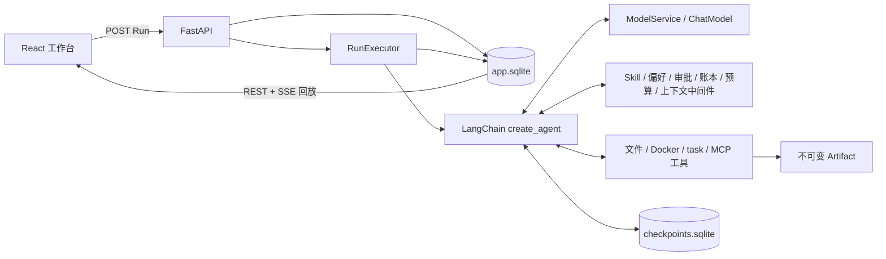

# AgentLoom 架构与边界

## 一条 Run 的数据流

1. HTTP 层先把 HumanMessage 与 pending Run 原子写进业务库，同一线程只允许一个未结束 Run。
2. `RunExecutor` 的后台 Task 拥有图执行；SSE 断开只影响读取，不取消 Run。
3. `create_loom_agent` 把模型、工具、`LoomState`、`LoomContext`、checkpoint 和中间件组装成唯一正式执行链。
4. 模型只提出 tool call；应用在真实执行点重新校验权限、预算、审批与幂等账本。
5. ToolMessage 通过同一个 `tool_call_id` 回到模型。最终消息、事件与 usage 写回 app.sqlite。
6. LangGraph checkpoint 保存可恢复图状态；数据库服务、Secret、锁和运行句柄只放在 `LoomContext`，不会序列化。

## 框架、协议与 AgentLoom 代码

| 层 | 使用的能力 | AgentLoom 自己实现的部分 |
| --- | --- | --- |
| LangChain/LangGraph | `create_agent`、ToolNode、消息、middleware hook、checkpoint | 状态字段、组装顺序、共享预算、审批/账本/权限、恢复语义 |
| FastAPI | 路由、请求校验、lifespan、SSE 响应 | Run 入场幂等、后台任务所有权、事件协议、REST 投影 |
| SQLAlchemy/Alembic/SQLite | ORM、事务、迁移、WAL | 九表业务约束、状态 CAS、事件序号、工具/审批去重 |
| Docker | 容器进程与隔离原语 | 非 root、无网络、只读根、受控挂载、超时/取消清理 |
| MCP SDK | stdio 协议、发现、调用 | 受信任 Server 配置、稳定命名、超时隔离、账本接入 |
| React/TanStack Query | 页面、缓存与组件状态 | SSE reducer、刷新恢复、审批/任务/产物工作台、安全预览 |
| DeerFlow | 学习和设计参照 | AgentLoom 不导入 DeerFlow；按单用户小系统重新实现 |

## 关键代码地图

| 能力 | 入口 |
| --- | --- |
| Agent 组装 | `backend/src/agentloom/agents/factory.py::create_loom_agent` |
| Run 入场与状态机 | `backend/src/agentloom/runtime/manager.py::RunManager` |
| 后台执行/取消/恢复 | `backend/src/agentloom/runtime/executor.py::RunExecutor` |
| 审批与工具账本 | `backend/src/agentloom/agents/middleware.py` |
| 工作区与 Artifact | `backend/src/agentloom/sandbox/workspace.py`、`artifacts/service.py` |
| 子 Agent | `backend/src/agentloom/subagents/executor.py::SubagentExecutor` |
| MCP 与偏好 | `backend/src/agentloom/mcp/manager.py`、`memory/service.py` |
| 真实评测 | `backend/src/agentloom/evaluation/runner.py::EvaluationRunner` |
| UI 事件合并 | `frontend/src/run-state.ts::reduceRunEvent` |

## 支持边界

- 单用户、单 Gateway worker、本机 loopback；没有账号、租户和远程部署安全保证。
- 同线程最多一个未结束 Run；不同线程受全进程容量控制。
- Bash 只在 Docker 中运行。Docker 不可用时明确拒绝，不回退宿主机 shell。
- MCP 首版仅支持配置内受信任的本地只读 stdio Server，没有远程 HTTP/OAuth 和聊天动态注册。
- 偏好必须显式创建或审批保存，没有自动记忆抽取、向量检索或通用 RAG。
- child 使用固定角色工具白名单，不递归委派，不直接写父 workspace。
- 模型计费没有配置单价，因此只报告 Token，不猜测金额。
